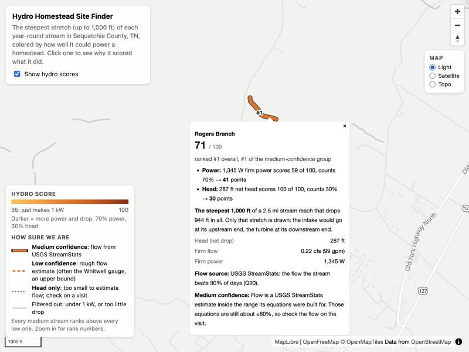
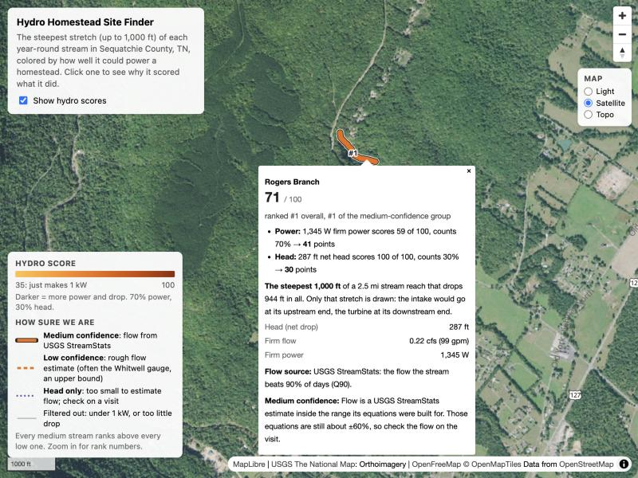

# Hydro Homestead Site Finder

A local map-based tool for finding land near Chattanooga, TN that could support a homestead powered by a small hydroelectric (micro-hydro) system.

## Goal

Produce a **shortlist of land worth visiting in person**: sites with a year-round stream that has enough drop and flow to generate at least 1 kW of continuous power, within about an hour's drive of Chattanooga. Each site lists its property parcel and owner so landowners can be contacted, **whether or not the land is listed for sale**.

This is different from a real estate search. It starts from the terrain and water, finds physically suitable land, and only then asks who owns it.

- Full requirements and engineering plan: [site-selection.md](site-selection.md)
- Open judgment calls and current answers (power target, search radius, scoring assumptions): [docs/DECISIONS.md](docs/DECISIONS.md)
- How head, flow and power are calculated, and every assumption behind them: [docs/ASSUMPTIONS.md](docs/ASSUMPTIONS.md)
- How corridors are scored and ranked: [docs/SCORING.md](docs/SCORING.md)

## Status

**v0.1, in progress.** Analyzed so far: Sequatchie County, TN (the default) and its neighbors Marion, Bledsoe, Grundy and Rhea, part of the 1-hour drive region around Chattanooga (D-02). Six streams across the five counties reach 1 kW; see [docs/SCORING.md](docs/SCORING.md#five-counties-part-13-profile-hydro_v3-2026-10-20).

| Works now | Not built yet |
| --- | --- |
| Loads the county boundary, every perennial (year-round) stream in the county and a 10 m elevation model into a local database and `data/raw/` | A way to spot spring-fed small streams (the low-flow estimates for small streams are typical-basin numbers) |
| Records each stream's elevation drop, length, slope, drainage area and estimated mean flow | |
| Hydro corridors: the steepest 1,000 ft stretch of each stream (where one penstock would get the most drop), found on the elevation model | |
| Map viewer: each stream's best stretch colored by its hydro score and styled by confidence, with a legend; click one for its score explained in plain words. Light, satellite or topo map underneath | |
| Hydro analysis: head over that stretch, reliable low flow (Q90 from USGS StreamStats, or, for streams too small for it, the typical StreamStats low flow per square mile of their river basin; the Whitwell stream gauge where StreamStats is down) and firm power, saved as a numbered run | |
| Scoring and ranking: streams of 1 kW or more scored 0–100 on power and head with an explanation for each score, ranked by confidence; streams under 1 kW on a rough flow estimate listed last as "low flow" | |
| Overall score (FR-7): hydro, buildability, agriculture and logistics combined 0–100, ranking each confidence tier, with each part explained, in the exports and the map popup | Privacy (FR-6), the fifth part: left out until it's built (D-15). Coloring the map by overall score |
| Exports: the ranked shortlist as CSV and GeoJSON, every stream with the reason it was or wasn't listed, and a summary report for planning visits | Parcels for Hamilton County (Chattanooga) and other counties outside the state's parcel layer |
| Parcels and owners: each stretch's turbine parcel (ID, acreage, owner) and every parcel it crosses, in the exports; property lines on the map. Owner names stay on this computer, never on the map | A minimum acreage filter (D-03 is open; small parcels are only flagged) |
| Flood zones: FEMA's flood zone at each stretch's turbine end and how much of the stretch is in the 100-year floodplain, in the exports and the map popup; flood zones on the map | |
| Roads and drive time: the 1-hour drive area from downtown Chattanooga (the search region, D-02) and the counties it touches; each stretch's nearest road and its type, the nearest public road, and the drive from Chattanooga, in the exports and the map popup; roads and the drive area on the map | The 15 other counties the 1-hour area touches (Hamilton and north Georgia first); Road frontage per parcel (FR-9) |
| Buildable ground: on each stretch's turbine parcel, how many acres are gently sloped (15% or less), outside the 100-year floodplain and on soils fit for a septic field (USDA soil survey), and how far the nearest of it is from the turbine end, in the exports and the map popup; that ground and the soils' septic ratings on the map | |
| Farmland: on each stretch's turbine parcel, acres of prime farmland and of cropland (land capability class 1–3), wet ground, and how much pasture its soils could grow (USDA soil survey), in the exports and the map popup; farmland soils on the map | Current land cover (which acres are already open field) |

## How it works

```
Public data services ──▶ hhsf (Python) ──▶ PostGIS database ──▶ Martin tile server ──▶ React map
(USGS, Census, TN)       download + load     (Docker)            (Docker)              (browser)
```

1. The **`hhsf` command-line tool** downloads public datasets for an area, converts units and coordinates, and loads them into the database.
2. **PostGIS** stores everything. Later analysis and scoring steps run here.
3. **Martin** serves database tables to the map as vector tiles.
4. The **React app** draws the map in your browser.

## Tech stack

| Layer | Technology | Purpose |
| --- | --- | --- |
| Data pipeline | Python 3.12, [uv](https://docs.astral.sh/uv/) | Download, convert and load data; later analysis and scoring |
| | [Typer](https://typer.tiangolo.com/) | The `hhsf` command-line tool |
| | [Shapely](https://shapely.readthedocs.io/), [pyproj](https://pyproj4.github.io/pyproj/) | Geometry and coordinate conversion |
| | [httpx](https://www.python-httpx.org/) | Calls to the public data services |
| | [SQLAlchemy](https://www.sqlalchemy.org/), [psycopg](https://www.psycopg.org/) | Database access |
| | [Alembic](https://alembic.sqlalchemy.org/) | Database schema migrations |
| | [Pydantic](https://docs.pydantic.dev/) | Typed settings and config files |
| Database | PostgreSQL 17 + [PostGIS](https://postgis.net/) 3.5 (Docker) | Spatial data storage and queries |
| Tile server | [Martin](https://maplibre.org/martin/) 1.16 (Docker) | Serves database tables as map tiles |
| Frontend | [React](https://react.dev/) 18, TypeScript, [Vite](https://vite.dev/) | The web app |
| | [MapLibre GL JS](https://maplibre.org/) | Interactive map |
| | [OpenFreeMap](https://openfreemap.org/) | Free basemap tiles (no API key) |
| | [USGS The National Map](https://www.usgs.gov/programs/national-geospatial-program/national-map) | Satellite and topo basemap tiles (no API key) |
| Testing and tooling | pytest, [Testcontainers](https://testcontainers.com/), Ruff | Tests (including throwaway databases) and linting |

## System requirements

| Requirement | Version | Notes |
| --- | --- | --- |
| OS | macOS, Linux, or Windows with WSL 2 | Tested on macOS (Apple Silicon) |
| Docker | Docker Desktop, OrbStack, or Docker Engine with Compose v2 | Must be running before `make up` |
| uv | 0.4+ | Installs Python 3.12 automatically; no system Python needed |
| Node.js | 20+ | For the map app |
| make | any | Preinstalled on macOS and Linux |
| Disk | ~2 GB free | Docker images plus one county of data. The full regional version will need far more (see [site-selection.md](site-selection.md)). |
| RAM | 8 GB+ | |
| Network | Internet access | To download data and basemap tiles |
| Free ports | 5433, 3100, 5173 | Database, tile server, map app |

## Getting started

### 1. Install prerequisites

- **Docker:** [Docker Desktop](https://www.docker.com/products/docker-desktop/) (any OS) or [OrbStack](https://orbstack.dev/) (Mac). Open it once so it's running.
- **uv:** follow the [install guide](https://docs.astral.sh/uv/getting-started/installation/), or on Mac run `brew install uv`.
- **Node.js 20+:** from [nodejs.org](https://nodejs.org/), or on Mac run `brew install node`.

### 2. Clone and install dependencies

```bash
git clone <repo-url>
cd hydro-homestead
make setup
```

### 3. Start the database and tile server

```bash
make up
```

This starts PostGIS and Martin in Docker and creates the database tables. Data is kept between restarts.

### 4. Load data

```bash
make ingest
```

This downloads the Sequatchie County boundary from Census, the stream data and the elevation model from USGS, the property parcels from the Tennessee Comptroller, the flood zones from FEMA, the roads from Census and the soils from USDA, then loads them. The first run downloads about **270 MB** of USGS stream files (one per river basin the county touches) plus about **84 MB** of elevation data, and takes **a couple of minutes** on a typical connection; after that the files are reused from `data/raw/` and a re-run takes about 30 seconds.

The elevation model is USGS 3DEP at 1/3 arc-second (about 10 m). USGS publishes it in 1×1 degree tiles (Sequatchie's is 472 MB), but only the part under the county's streams is read, about 84 MB, saved as a 48 MB file in `data/raw/usgs_3dep_13/`. To fetch just that step: `uv run hhsf ingest terrain`.

Parcels take about 10 seconds per county and are cached in `data/raw/tn_parcels/`. The state updates them monthly; `uv run hhsf ingest parcels --refresh` downloads them again. Owner names come with the parcels and are kept in their own table, which the map never reads (see [docs/ASSUMPTIONS.md](docs/ASSUMPTIONS.md#parcels-and-owners)). Flood zones come from FEMA, one county at a time, cached in `data/raw/fema_nfhl/` (about 50 MB for the five counties). FEMA's server is slow and drops connections under load, so the first download takes from a few seconds to about 5 minutes per county (Rhea, the largest); the tool retries, and a re-run reuses the cache and takes a few seconds. Roads come from the Census TIGER/Line file for the county (about 1 MB, a few seconds), cached in `data/raw/tiger_roads/`. Soils come from USDA's soil survey (SSURGO) through its Soil Data Access service, a few seconds per county, cached in `data/raw/usda_ssurgo/` (10–35 MB per county). Streams are saved as each file is read, so the map starts filling in before the run finishes. If it fails partway, run it again: nothing is lost or duplicated.

**Other counties.** Marion, Bledsoe, Grundy and Rhea are set up in `config/aoi/`. Run each step with `AOI=<key>`, one county at a time:

```bash
make ingest AOI=marion_tn
make analyze AOI=marion_tn
make score AOI=marion_tn
```

Keys: `marion_tn`, `bledsoe_tn`, `grundy_tn`, `rhea_tn`. They need two more river-basin files than Sequatchie (Upper Tennessee `0601`: 486 MB, Middle Tennessee-Elk `0603`: 152 MB). A new county's first `make analyze` takes 30 minutes to a couple of hours while StreamStats answers, longer if it keeps dropping out. The map shows every county you've scored, each ranked on its own.

<details>
<summary>Using the USGS web service instead of the file download</summary>

The older path queries the USGS web service box by box instead of downloading files. It's much slower (30 minutes to an hour for one county) and often times out, but downloads far less:

```bash
uv run hhsf ingest hydrography --source service
```

Each box is saved as it arrives and cached in `data/raw/`, so re-running resumes where it stopped. To make it the default, set `hydrography_source: service` in `config/data_sources.yaml`. Both paths load the same streams with the same IDs.

</details>

### 5. Run the hydro analysis

```bash
make analyze
```

For every stream this finds its **steepest stretch of up to 1,000 ft** on the elevation model (where one penstock would get the most drop), then works out the head over that stretch, a reliable low flow and the continuous power it could supply, and saves them to the `hydro_corridors` table as a new numbered run. A stream shorter than 1,000 ft is used whole. Low flows come from the USGS StreamStats service; if it outlines the wrong watershed for a stream, the tool asks again further up that stream. Streams too small for StreamStats' equations get the median StreamStats low flow per square mile of the bigger streams in their river basin (HUC8), marked low confidence. If the service is down, streams on the Sequatchie River side borrow the low flow measured at the USGS gauge near Whitwell, scaled by drainage area, also low confidence. Answers are cached in `data/cache/`, so a re-run only asks for what's missing. The first full run takes about 30 minutes while StreamStats answers. If it's down, the run still finishes with fallback estimates, clearly flagged, and says how many streams were affected ("StreamStats looks unavailable: N reaches…"); run it again later. What each number means and where it comes from: [docs/ASSUMPTIONS.md](docs/ASSUMPTIONS.md).

### 6. Score and rank

```bash
make score
```

Scores the latest hydro run and prints the top 20. Streams of 1 kW or more get a 0–100 hydro score (70% power, 30% head), and every score is saved with an explanation of how it was reached. The list is ranked by confidence first: every stream whose low flow came from StreamStats ranks above every stream whose flow is a rougher estimate, then streams with no flow estimate ("head only"), then streams under 1 kW on a rough flow estimate ("low flow"). Streams under 1 kW on a StreamStats flow are dropped, and so is any stream with under 10 ft of net head (too little drop for a small turbine). Within each confidence group, streams are ordered by an **overall score** (FR-7): the hydro score plus how buildable, farmable and reachable the site is (Hydro 40%, Buildability 20%, Agriculture 20%, Logistics 10%; Privacy, 10%, isn't built yet, so the others are rescaled, D-15). It reads the buildable ground, farmland, roads and drive times as they are when it runs, so run `make score` again after `make analyze` or `make drive-time`; anything missing is left out of the overall score, not counted as zero. Each scoring is saved as a new numbered run in the `hydro_scores` table. Details: [docs/SCORING.md](docs/SCORING.md).

`make analyze` also works out the **buildable ground** on each stretch's turbine parcel (`uv run hhsf analyze buildable`, about 30 seconds per county): 10 m cells sloped 15% or less, outside FEMA's 100-year floodplain, on soils not rated Very limited for a septic field, in patches of at least half an acre. The first time, it extends the saved elevation model to cover the biggest parcels (a minute or two). Load every county's soils (`make ingest`) before analyzing any of them, or a parcel that reaches into an unloaded county is flagged `soils_not_loaded`. The thresholds are in `config/buildability.yaml`; nothing is filtered on them, but they feed the overall score's Buildability part (D-13, D-15). See [docs/ASSUMPTIONS.md](docs/ASSUMPTIONS.md#buildable-ground).

It also adds up the **farmland** on each turbine parcel (`uv run hhsf analyze farmland`, a few seconds per county), from the same soil survey: acres of NRCS prime farmland, of cropland (land capability class 1–3), of wet ground, and the pasture its soils could grow in animal-unit months a year (12 feed one cow for a year). The whole parcel counts, steep or in the floodplain. The thresholds are in `config/farmland.yaml`; nothing is filtered on them, but they feed the overall score's Agriculture part (D-14, D-15). See [docs/ASSUMPTIONS.md](docs/ASSUMPTIONS.md#farmland).

### 7. Drive times from Chattanooga

```bash
make routing
make drive-area
make drive-time
```

`make routing` starts [Valhalla](https://github.com/valhalla/valhalla), a routing engine, in Docker. The first time, it downloads OpenStreetMap road data for Tennessee, Georgia and Alabama (about 700 MB, into `data/valhalla/`) and builds a road graph from it, which took about 6 minutes here; later starts take seconds. `make up` doesn't start it; `make down` stops it.

`make drive-area` builds the area within a 1-hour drive of downtown Chattanooga (D-02: the search region) and lists the counties it touches, with how much of each is inside, and which ones are already analyzed. `make drive-time` (per county, like the other steps: `AOI=<key>`) works out the drive from downtown Chattanooga to the bottom of every stream's stretch. Both are by car with no traffic. Run `make drive-time` again after each `make analyze`: a new hydro run has new stretches. The origin and the 60 minutes are in `config/drive_time.yaml`. Nothing is filtered or re-ranked on drive time or road distance; they're columns and flags. See [docs/ASSUMPTIONS.md](docs/ASSUMPTIONS.md#roads-and-drive-time).

### 8. Export the shortlist

```bash
make export
```

Writes the latest scoring to `data/outputs/sequatchie_tn/run_<N>/` (N is the score run number):

| File | What's in it |
| --- | --- |
| `report.md` | Summary for planning visits: which runs and data it came from, the assumptions used, how many streams made the list, the top 20 of each confidence tier with each one's turbine parcel, owner, flood zone, buildable acres, distance to a public road and drive time, how many stretches are in a flood zone, outside the 1-hour drive or have no buildable ground or farmland, and the caveats. Start here. |
| `shortlist.csv` | Every ranked stream, best first: score, net head (ft), firm power (W), firm flow (cfs and gallons per minute), drainage area (sq mi), the stretch's length (ft) and the whole stream's (mi), how the flow was estimated, a lat/lon point at the bottom of the stretch (where a turbine would go), and a one-line explanation. Then the property: the turbine parcel's ID, county, acreage (measured and on the deed), owner(s), street address and a link to its record on the Comptroller's site, plus every parcel the stretch crosses and their owners, and flags such as `parcel_under_min_acres`. Then flooding: FEMA's zone at the turbine end (`turbine_flood_zone`, e.g. A, AE or X, and its subtype), whether that's in the 100-year floodplain (`turbine_in_sfha`), how many feet of the stretch are (`stretch_sfha_ft`), and `flood_flags` such as `turbine_in_floodway` or `flood_zone_not_mapped`. Then access: the nearest road to the turbine end (`turbine_road_ft`, its type and name), the nearest public road (`turbine_public_road_ft`), the drive from downtown Chattanooga (`drive_minutes`, `drive_miles`), whether the turbine end is in the 1-hour area (`in_drive_area`), and `access_flags` such as `outside_drive_area` or `nearest_road_not_public`. Then the house site: the turbine parcel's gently sloped acres (`turbine_parcel_gentle_acres`), its buildable acres (also outside the floodplain and on septic-suitable soils, `turbine_parcel_buildable_acres`), how far the nearest of it is from the turbine end (`nearest_buildable_ft`), and `buildable_flags` such as `no_buildable_ground`. Then farming: the turbine parcel's prime farmland (`turbine_parcel_prime_acres`, plus `turbine_parcel_prime_if_acres` for prime only if drained or protected from flooding, and `turbine_parcel_statewide_acres`), its class 1–3 cropland (`turbine_parcel_cropland_acres`), wet ground (`turbine_parcel_wet_acres`), the pasture its soils could grow (`turbine_parcel_pasture_aum`, animal-unit months a year), and `farmland_flags` such as `no_farmland`. Opens in Excel or Google Sheets. |
| `shortlist.geojson` | The same stretches as map lines, for QGIS, Google Earth or [geojson.io](https://geojson.io). Parcel IDs and acreage, but no owner names. |
| `all_corridors.csv` | Every stream, including the ones that were dropped, with the reason. Use it to answer "why isn't this stream on the list?". |

**The CSVs and the report name property owners. That's personal information: keep them to yourselves, and don't post them or paste them into issues.** Parcels are matched when you export, so run `make export` again after re-ingesting parcels.

Exporting again overwrites that run's folder; earlier runs' folders are kept. `uv run hhsf export hydro --run-id N` exports an older score run.

### 9. Open the map

```bash
make web
```

Open <http://localhost:5173>. The map shows the latest `make score` run (refresh the page after scoring again):



| On the map | What it means |
| --- | --- |
| **Where the line is** | Only each stream's best stretch (up to 1,000 ft) is drawn, not the whole stream. Zoom in to see where it sits. |
| **Color** (light amber to dark brown) | Hydro score, 35 to 100. Darker means more power and more drop. About 35 is a stream that just reaches 1 kW. |
| **Thick solid line with a dark outline** | Medium confidence: the low flow is a USGS StreamStats estimate. These rank above everything else. |
| **Dashed line** | Low confidence: 1 kW or more, but on a rougher flow estimate. |
| **Purple dotted line** | Head only: the basin is too small for any flow estimate, so it's ranked on drop alone. Check the flow on a visit. |
| **Thin blue line** | Low flow: under 1 kW on a rough flow estimate (mostly small streams). Listed last; worth a look only if a visit finds a spring. |
| **Faint grey line** | Filtered out: under 1 kW on a StreamStats flow, or too little drop for a turbine. |
| **#12** labels (zoom in) | The stream's rank on its county's shortlist. |

To change the map underneath, click the layers button (two stacked sheets) under the zoom buttons and pick a thumbnail. The map remembers your choice next time:

| Map | Use it for |
| --- | --- |
| **Light** (default) | Reading the scores: plain grey streets and place names, so the colors stand out. |
| **Satellite** | Scouting a visit: access roads, clearings, houses and tree cover around a stretch. Aerial photos from USDA's farm survey (NAIP), about 1 m per pixel, taken in summer. Street and place names stay on top. |
| **Topo** | Terrain: USGS topo map with contour lines, so you can see how steep the ground is around a stretch. |

Satellite and topo come from the USGS National Map and stop sharpening past about 1:9,000 (zoom 16); closer than that the map just enlarges them. On both, streams and scores get a white outline so they show up on the darker background.



Click a stretch to see its score and why: how many points power and head each added, which part of the stream it is (how long the stretch is, and how long the whole stream is and how much it drops), the net head (ft), firm flow (cfs and gallons per minute), firm power (W), where the flow number came from, the confidence group and any warnings. The popup also shows the **turbine parcel** (the parcel under the bottom of the stretch: its ID and acreage) and how many parcels the stretch crosses, then the **FEMA flood zone** at the turbine end and how much of the stretch is in the 100-year floodplain. Tick **Show property lines** to draw parcel outlines (pink; pale yellow on satellite) from zoom 12. Owner names are only in the exports. Tick **Show FEMA flood zones** to shade floodways (dark blue), the rest of the 100-year floodplain (blue) and the 0.2% annual chance ("500-year") area (pale blue) from zoom 10; the rest is FEMA zone X, minimal hazard, and isn't shaded. The popup's last two lines are the **nearest road** (Census TIGER/Line: distance, type and name, and the nearest public road if that's farther) and the **drive from Chattanooga** (minutes and miles, and whether it's inside the 1-hour area). Tick **Show Census roads** to draw roads from zoom 10 (orange: public; dashed brown: 4WD trails and private roads), and **Show 1-hour drive from downtown Chattanooga** to outline the search region in green. The **Buildable ground** line is the turbine parcel's buildable acres (gently sloped, outside the 100-year floodplain, on septic-suitable soils) and how far the nearest of it is from the turbine end. The **Farmland** line is the turbine parcel's prime farmland and class 1–3 cropland acres, and roughly how many cows its soils could pasture for a year. Tick **Show buildable ground on turbine parcels** to shade that ground green, **Show farmland soils** to shade prime farmland (dark green), prime farmland if drained or protected from flooding (light green) and other class 1–3 cropland (gold), and **Show soils rated for septic** to shade the USDA soil map by its Tennessee septic rating (green slightly, yellow moderately, magenta very limited), all from zoom 11.

Untick **Show hydro scores** to go back to plain streams (bigger streams darker), where a click shows elevation drop, length, slope, drainage area and estimated mean flow.

### Stopping

```bash
make down
```

### Backing up

```bash
make backup
```

Saves the whole database to `data/backups/hhsf-<date>-<time>.dump` (about 64 MB for the five counties, a few seconds). Worth doing after any long run: rebuilding from scratch means re-running every step, and on a new computer without `data/cache/` the StreamStats answers alone took about 11 hours for four counties. **The backup includes property owner names, so keep it private:** don't commit it, share it or put it in a synced folder others can open.

To go back to a backup:

```bash
make restore FILE=data/backups/hhsf-20261020-234756.dump
```

This **replaces everything in the database** with the backup's contents, then restarts the tile server. Run `make restore` with no `FILE` to list the backups. If the backup is older than your code, run `make up` afterwards to apply the newer migrations. `make down` doesn't delete data, so a backup is only needed for mistakes, a new computer, or before something risky.

### Running it on a private server

To keep the map running on another machine (a home server, a Proxmox container or VM), so you don't need a laptop open to look at it. **Keep it private:** the database holds property owner names, so reach it only over a private network such as [Tailscale](https://tailscale.com/), never a public address. Every port in `docker-compose.yml` is published on `127.0.0.1` only for the same reason.

The server needs Docker with Compose, uv and make (Node isn't needed: the map is built inside Docker). About 4 CPUs, 8 GB of RAM (the drive-time road graph is the peak) and 30–40 GB of disk.

1. **Copy the database instead of rebuilding it.** On the computer that has the data, run `make backup`. Copy the `.dump` file to the server privately (`scp` or over Tailscale).
2. **On the server**, clone the repo and start the database:

   ```bash
   git clone <repo-url> hydro-homestead && cd hydro-homestead
   uv sync
   make up
   make restore FILE=data/backups/<name>.dump
   make up        # applies any migrations newer than the backup
   ```

3. **Start the map:** `make serve`. It builds the map and serves it, with the map tiles, on <http://127.0.0.1:8080> (set `HHSF_WEB_ADDR` to change the address). It restarts with Docker.
4. **Reach it privately.** With Tailscale on the server, `tailscale serve --bg 8080` serves it over HTTPS on your tailnet only.

To re-run steps on the server too (ingest, analysis, drive times), also copy `data/raw/` (downloaded source files, ~1.4 GB), `data/cache/` (StreamStats answers, which took about 11 hours to collect) and `data/valhalla/` (the drive-time road graph, ~3.3 GB, 5–30 minutes to rebuild). After pulling new code: `make up` for migrations, then `make serve` to rebuild the map.

## Usage

Run `make` to list all commands.

| Command | What it does |
| --- | --- |
| `make setup` | Install Python and Node dependencies |
| `make up` | Start the database and tile server, apply migrations |
| `make ingest` | Download and load data for the default area |
| `make ingest AOI=<key>` | Same, for another area defined in `config/aoi/` |
| `uv run hhsf ingest hydrography --source service` | Reload streams from the USGS web service instead of the file download |
| `uv run hhsf ingest terrain` | Just the elevation model step (after the streams are loaded) |
| `uv run hhsf ingest parcels --aoi <key>` | Just the parcels step; add `--refresh` to download the monthly update |
| `uv run hhsf ingest flood --aoi <key>` | Just the FEMA flood zones step; add `--refresh` to download again after a flood map revision |
| `uv run hhsf ingest roads --aoi <key>` | Just the Census roads step; add `--refresh` to download again |
| `uv run hhsf ingest soils --aoi <key>` | Just the USDA soils step; add `--refresh` to download again (soil surveys update yearly) |
| `make routing` | Start the Valhalla drive-time service (the first start downloads OpenStreetMap and builds a road graph) |
| `make drive-area` | Build the 1-hour drive area from downtown Chattanooga and list the counties it touches (after `make routing`) |
| `make drive-time AOI=<key>` | Drive time from downtown Chattanooga to each stretch of the latest hydro run (after `make routing` and `make analyze`) |
| `make analyze` | Find each stream's steepest stretch, then compute head, low flow and firm power for it, and the buildable ground and farmland on its turbine parcel (after `make ingest`) |
| `uv run hhsf analyze buildable --aoi <key>` | Just the buildable-ground step, for the latest hydro run (after changing `config/buildability.yaml`, or re-ingesting parcels, flood zones or soils) |
| `uv run hhsf analyze farmland --aoi <key>` | Just the farmland step, for the latest hydro run (after changing `config/farmland.yaml`, or re-ingesting parcels or soils) |
| `uv run hhsf analyze hydro --penstock-ft 2000` | Same, allowing a longer penstock (D-08 sensitivity check) |
| `uv run hhsf analyze hydro --no-terrain` | Same, but each whole stream is one corridor (the old method; overstates long streams) |
| `uv run hhsf analyze hydro --no-streamstats` | Same, without calling StreamStats (every flow is a low-confidence fallback) |
| `uv run hhsf analyze hydro --no-gauge` | Same, without the stream gauge fallback |
| `uv run hhsf analyze hydro --no-regional-yield` | Same, but small streams get the gauge estimate in its basin and no flow elsewhere (ranked head only), the D-09 starting rule |
| `uv run hhsf score hydro --profile hydro_v3` | Score with the previous rules: the same list, but each confidence group ordered by hydro score alone (no overall score) |
| `uv run hhsf score hydro --profile hydro_v2` | Score with the previous rules: a stream of 1 kW or more is scored however little drop it has |
| `uv run hhsf score hydro --profile hydro_v1` | Score with the oldest rules: also drops streams under 1 kW on a rough flow estimate |
| `make score` | Score and rank the latest hydro run with the overall score (after `make analyze`, and again after `make drive-time`) |
| `uv run hhsf score hydro --profile <version> --run-id <N>` | Score a specific hydro run with another scoring profile from `config/scoring_profiles/` |
| `make export` | Write the latest scores to `data/outputs/` as CSV, GeoJSON and a summary report (after `make score`) |
| `uv run hhsf export hydro --run-id <N>` | Export a specific score run |
| `make web` | Run the map at <http://localhost:5173> |
| `make serve` | On a server: build the map and serve it with the tiles at <http://127.0.0.1:8080> (see [Running it on a private server](#running-it-on-a-private-server)) |
| `make test` | Run all tests (Docker must be running) |
| `make lint` | Check code style |
| `make backup` | Save the whole database to `data/backups/` (includes owner names: keep it private) |
| `make restore FILE=<path>` | Replace the database with a backup, then restart the tile server |
| `make down` | Stop services (data is kept) |

The pipeline tool can also be run directly:

```bash
uv run hhsf --help
```

## Configuration

| File | What it controls |
| --- | --- |
| `config/aoi/*.yaml` | Areas of interest. One file per county: Census ID, a buffer distance, (optionally) the river basins (HU4 codes) it spans, and (optionally) a reference stream gauge for low flows. Add a file to analyze another county; no code changes needed. If you leave out `huc4`, the basins are looked up automatically. |
| `config/data_sources.yaml` | Where each dataset is downloaded from, plus license and version notes. `hydrography_source` picks the stream source: `bulk` (file download, default) or `service` (web service). The `streamstats` section lists its endpoints and how hard to call it. |
| `config/hydro.yaml` | Hydro analysis assumptions: the longest penstock a corridor may assume (1,000 ft), efficiency, net-head and diversion allowances, the 1 kW target, which StreamStats statistic to use, and where to ask StreamStats again when it outlines the wrong watershed (`pour_point_retry_shares`, `min_pour_point_area_share`). Values come from [docs/DECISIONS.md](docs/DECISIONS.md); change them here and re-run. |
| `config/parcels.yaml` | The minimum-acreage placeholder (D-03) that flags small parcels in the exports. |
| `config/buildability.yaml` | What counts as buildable ground (D-13): the steepest slope (15%), which septic rating and which of its classes rule ground out, and the smallest patch (half an acre). Change it, then run `uv run hhsf analyze buildable --aoi <key>`. |
| `config/farmland.yaml` | What counts as farmland (D-14): the highest land capability class counted as cropland (3) and which drainage classes count as wet. Change it, then run `uv run hhsf analyze farmland --aoi <key>`. |
| `config/drive_time.yaml` | Where drives start (downtown Chattanooga, a placeholder for an address), how long (60 minutes, D-02), and which roads a drive may end on. Change it, then run `make drive-area` and `make drive-time` again. The OpenStreetMap downloads are listed in `docker-compose.yml` (the `routing` service). |
| `config/scoring_profiles/*.yaml` | Scoring rules: the 1 kW cutoff, the head and power breakpoints, the 70/30 weights and the confidence tiers. To change one, copy the file to a new version and score again (see [docs/SCORING.md](docs/SCORING.md)). |
| `.env` (optional) | Override the database connection (`DATABASE_URL`). Copy from `.env.example`. Only needed if you change the database port. |

## Project structure

```
hydro-homestead/
├── README.md
├── site-selection.md        # Requirements and engineering plan
├── docs/DECISIONS.md        # Judgment calls and their current answers
├── docs/ASSUMPTIONS.md      # How hydro numbers are calculated
├── docs/SCORING.md          # How corridors are scored and ranked
├── docs/images/             # Screenshots for this README
├── Makefile                 # Common commands
├── docker-compose.yml       # PostGIS + Martin, and Valhalla (drive times)
├── pyproject.toml           # Python dependencies and tool settings
├── alembic.ini
├── config/
│   ├── aoi/                 # Areas of interest
│   ├── data_sources.yaml    # Dataset endpoints and licenses
│   ├── hydro.yaml           # Hydro analysis assumptions
│   ├── parcels.yaml         # Minimum-acreage placeholder (D-03)
│   ├── drive_time.yaml      # Drive-time origin and minutes (D-02)
│   ├── buildability.yaml    # What counts as buildable ground (D-13)
│   ├── farmland.yaml        # What counts as farmland (D-14)
│   └── scoring_profiles/    # Versioned scoring rules
├── src/hhsf/                # Python pipeline
│   ├── cli.py               # `hhsf` command-line tool
│   ├── core/                # Config, database, coordinate systems, units
│   ├── ingest/              # Downloading and loading each dataset
│   └── analysis/            # Hydro calculations, StreamStats and Valhalla clients, scoring, runs, exports
├── migrations/versions/     # Database table definitions
├── martin/martin.yaml       # Which tables the tile server publishes
├── frontend/                # React + MapLibre map app (src/scores.ts: score colors and popup; src/basemaps.ts and BasemapControl.ts: light, satellite and topo maps)
├── tests/
│   ├── unit/                # Fast, no Docker needed
│   ├── integration/         # Starts a throwaway PostGIS in Docker
│   └── fixtures/            # Small synthetic test data
└── data/                    # Downloaded data cache and exports (not committed)
    ├── valhalla/            # OpenStreetMap downloads and Valhalla's road graph
    └── outputs/             # `make export` results, one folder per score run
```

## Data sources

| Data | Source | License |
| --- | --- | --- |
| County boundaries | [US Census TIGERweb](https://tigerweb.geo.census.gov/) | Public domain |
| Low-flow estimates (Q90) | [USGS StreamStats](https://streamstats.usgs.gov/) with the Tennessee regression equations (USGS SIR 2009-5159) | Public domain |
| Measured stream flow | [USGS NWIS](https://waterdata.usgs.gov/) daily flows at gauge 03571000 (Sequatchie River near Whitwell), and [WBD](https://www.usgs.gov/national-hydrography/watershed-boundary-dataset) basin boundaries (for the gauge's basin and the regional yield) | Public domain |
| Elevation model (10 m) | [USGS 3DEP](https://www.usgs.gov/3d-elevation-program) 1/3 arc-second DEM, cloud-optimized GeoTIFF tiles from the National Map (only the part under the AOI's streams is downloaded: about 84 MB for Sequatchie) | Public domain |
| Streams, elevations, drainage area, flow estimates | [USGS NHDPlus High Resolution](https://www.usgs.gov/national-hydrography/nhdplus-high-resolution) (final release; HU4 file geodatabases from the National Map, or its web service) | Public domain |
| Property parcels and owners | [Tennessee Comptroller of the Treasury](https://comptroller.tn.gov/office-functions/pa/gisredistricting/redistricting-and-land-use-maps/parcel-data.html) statewide parcel layer ("Tennessee Property Boundaries Public Use", on TNMap), 86 counties, updated monthly | Public service, not for commercial use, no warranty. Owner names are personal information: local exports only |
| Flood zones | [FEMA National Flood Hazard Layer](https://www.fema.gov/flood-maps/national-flood-hazard-layer) (effective flood maps, ArcGIS service at hazards.fema.gov). All five counties have countywide digital maps (2008–2010, some panels revised 2025) | US Government work, generally public domain (FEMA states no license). A planning screen, not a flood determination |
| Soils: septic ratings, farmland class, land capability class, pasture yields | [USDA NRCS Soil Survey Geographic database (SSURGO)](https://www.nrcs.usda.gov/resources/data-and-reports/soil-survey-geographic-database-ssurgo), through [Soil Data Access](https://sdmdataaccess.nrcs.usda.gov/). One survey per county (TN + county FIPS), updated yearly | Public domain. Cite "Soil Survey Staff, NRCS, USDA. Soil Survey Geographic (SSURGO) Database". A planning screen, not a septic site evaluation |
| Roads | [US Census TIGER/Line](https://www.census.gov/geographies/mapping-files/time-series/geo/tiger-line-file.html) roads, one file per county (2025 release) | Public domain |
| Drive times and the 1-hour area | [Valhalla](https://github.com/valhalla/valhalla) routing engine (MIT), run locally, on [OpenStreetMap](https://www.openstreetmap.org/copyright) roads for TN, GA and AL ([Geofabrik](https://download.geofabrik.de/) extracts) | ODbL: credit "© OpenStreetMap contributors" wherever drive times or the area are shown |
| Basemap (Light) | [OpenFreeMap](https://openfreemap.org/), © [OpenStreetMap](https://www.openstreetmap.org/copyright) contributors | ODbL |
| Basemap (Satellite, Topo) | [USGS The National Map](https://www.usgs.gov/programs/national-geospatial-program/national-map) tile services USGSImageryOnly (USDA NAIP aerial photos) and USGSTopo | Public domain |

Planned sources (soils, building footprints, rainfall) are listed in [site-selection.md §4](site-selection.md).

## Testing

```bash
make test
```

Unit tests run without Docker. They include reading a tiny synthetic NHDPlus HR file built during the test, so no large files are needed, the steepest-stretch search on made-up elevation profiles and a tiny made-up elevation model, the head, flow and power calculations against a fake StreamStats service (no network), and every scoring and ranking rule. Integration tests start a temporary PostGIS container, run the migrations, load sample streams, check that re-loading doesn't create duplicates, and run the hydro analysis (with and without an elevation model), scoring and exports, including linking corridors to parcels and checking that owner names reach the CSVs but not the GeoJSON, and linking corridors to flood zones (the floodway wins where zones meet; turbine ends off the map are flagged), and to roads (interstates never count as the nearest road) and drive times, and working out buildable ground on a made-up parcel with a made-up elevation model, floodplain and soils, and its farmland acres and pasture from made-up soils. Unit tests check the slope calculation on tilted planes, the soil ratings' dominant condition, the pasture yield of a map unit's main soil, and that small patches and ground with no soil data don't count. The Valhalla client is tested against a fake service: batching, a request that fails over one point, and points with no route to a public road. A unit test fails if any map layer in `martin/martin.yaml` gets an owner or address column.

To see test coverage of the calculation code:

```bash
uv run pytest --cov=hhsf.analysis --cov-report=term-missing
```

## Known issues and blockers

### Current

- **The USGS stream web service is slow and unreliable, so it's no longer the default.** It often takes minutes per request or returns `504 Gateway Timeout`; one county took about 30 minutes. `make ingest` now downloads the NHDPlus HR file for each river basin (HU4 region) instead: about 270 MB for Sequatchie County (Cumberland `0513`: 193 MB, Middle Tennessee-Hiwassee `0602`: 74 MB), cached in `data/raw/nhdplus_hr_bulk/`. Both sources load the same 989 perennial reaches with identical IDs and attributes. The web service path is still there (`--source service`) and now saves each box as it arrives.
- **Some regions are large downloads.** Basin files range from about 75 MB to over 2 GB (e.g. Lower Ohio `0512`: 2.4 GB). Check the sizes before adding an AOI in a new basin; the ingest prints each file's size as it starts downloading.
- **Use the "VPU/Current" USGS files, not "Beta".** USGS also publishes older "Beta" files. For the Tennessee River basin (`0602`) they give many streams different IDs from the web service, which would break anything matched on IDs later. `config/data_sources.yaml` points at the current folder.
- **StreamStats is sometimes down or slow.** Its basin-characteristics service returned 502 errors all day on 2026-10-18 and was back on 2026-10-19. On 2026-10-20 it dropped out over a dozen times between 11:00 and 20:00, so the four new counties took about 11 hours instead of 2. When it's down, larger streams fall back to the gauge estimate (Sequatchie River basin), the regional yield or the NHDPlus *mean* flow, all marked low confidence, and the run says how many streams that hit; run `make analyze` again later. A run that hit an outage is not a usable result. Finished answers are cached. USGS asks for no more than 4 simultaneous requests, which the tool respects.
- **The gauge fallback is rough.** It assumes every square mile yields the same low flow as the 402 sq mi Whitwell basin, while the streams here are under 70 sq mi. Where both exist, it gives a median of about **10× StreamStats' low flow**, probably because the gauge's basin includes the spring-fed limestone valley. Treat gauge-based numbers as an upper bound. Since D-09 was decided it's only used for 4 larger streams StreamStats can't outline. Details in [docs/ASSUMPTIONS.md](docs/ASSUMPTIONS.md).
- **Most streams are too small for the low-flow equations.** Tennessee's equations only apply to basins of 1.3 sq mi or more; 635 of Sequatchie's 989 perennial reaches are smaller. They all get a **regional yield**, the typical StreamStats low flow per square mile of the bigger streams in the same river basin (HUC8), marked low confidence and flagged `below_regression_min_drainage_area`. It's an extrapolation and can't see springs; on the Collins River side StreamStats' own basin data suggests it may be up to 5× low, and on the Sequatchie Valley floor spring-fed streams can carry 5–10× more. See [docs/ASSUMPTIONS.md](docs/ASSUMPTIONS.md#regional-low-flow-yield) and [DECISIONS.md D-09](docs/DECISIONS.md).
- **Only six streams in five counties clear 1 kW over a 1,000 ft penstock**, all on StreamStats flows: Rogers Branch (Sequatchie), an unnamed stream and Bethel Creek (Marion), and Negro Den Creek, the Elk River headwater and Big Creek (Grundy), at 1.0–1.6 kW. Bledsoe and Rhea have none. In Sequatchie only Rogers Branch does (about 1.3 kW). Head is measured over each stream's steepest 1,000 ft stretch (D-08) instead of the whole stream, which brought the largest ranked net head down from 1,101 ft to 414 ft. Five plateau-edge streams made 1.1–1.5 kW on the gauge estimate; on the regional yield they make 105–146 W and are now ranks 2–6, at the top of the low-flow list. The penstock length matters a lot: before the regional yield, 1 / 6 / 19 streams reached 1 kW at 500 / 1,000 / 2,000 ft (0 / 1 / 3 on StreamStats flows). Worth deciding what pipe length is realistic. See [docs/DECISIONS.md D-08](docs/DECISIONS.md) and [docs/ASSUMPTIONS.md](docs/ASSUMPTIONS.md#how-the-steepest-stretch-is-found).
- **StreamStats sometimes outlines the wrong watershed.** It moves each point onto its own stream grid, which can land on a bigger stream at a confluence or on a hillside next to the creek. When the area it finds is more than 25% off NHDPlus's, the tool asks again 25%, 50% and 75% of the way up the stream and scales the answer back down to the stream's end. In Sequatchie that fixed 18 of the 22 wrong answers: the larger Walden Ridge creeks (Soddy, North Suck, Cain, Conner and others) that had been on the NHDPlus *mean annual* flow, 130–190× their dry-season flow. Thirteen of them had been on the shortlist at 1–21 kW; on dry-season flow none reaches 200 W. The other 4 still use the gauge estimate. See [docs/ASSUMPTIONS.md](docs/ASSUMPTIONS.md#when-streamstats-snaps-to-the-wrong-stream).
- **The stretch search uses 10 m elevations along the mapped stream line.** It can miss a small waterfall, read a few meters high where the line runs along a bank, and measures pipe length along the stream (a real pipe can cut bends). Each stretch is capped at the drop NHDPlus gives the whole stream. Confirm the drop on the visit.
- **Most of the ranked list is "low flow".** The 272 "head only" streams that used to fill most of the list now have a power estimate from the regional yield, and no small stream reaches 1 kW on it (best 146 W, median 9 W). Rather than drop them, the list keeps 575 of them last, ordered by power (D-01, D-09): their flow is a typical-basin number, so a spring-fed one with lots of head could still work. They need a dry-season flow check on the visit. A second reference gauge was tried instead and rejected: Collins River near McMinnville runs 10× high like Whitwell, and the Walden Ridge gauges disagree with each other. See [docs/SCORING.md](docs/SCORING.md).
- **The regional yield differs by county.** Each county's run builds the small-stream yield from its own StreamStats streams, and some differ 3–4× in the same river basin: Bledsoe's part of the Sequatchie River basin gets 0.068 cfs per sq mi against Sequatchie's 0.019, and Marion's Battle Creek side 0.083 against Grundy's 0.022. So a stream within 500 m of a county line, analyzed for both counties, can make 3–4× more power in one county's run than the other's. The map shows each stream once, with the numbers of the county it sits in; the exports list it in both. Pooling the yield across counties would fix it. See [docs/SCORING.md](docs/SCORING.md#five-counties-part-13-profile-hydro_v3-2026-10-20).
- **Ranks are per county.** Each county has its own #1, so the map shows several. The popup says which county a rank is in.
- **Parcel lines are for reference, not surveys.** The state's layer is "not intended for commercial use" and comes with no warranty; owner names can lag a sale. Check the deed through the parcel's TPAD link before contacting anyone. Details: [docs/ASSUMPTIONS.md](docs/ASSUMPTIONS.md#parcels-and-owners).
- **140 ranked stretches have no parcel.** They end outside the five counties (streams within 500 m of a county line are analyzed for both counties), where no parcels are loaded. Streams are often property lines, so a stretch usually crosses the parcels on both banks; the turbine parcel is just the one under its bottom end.
- **Soils are the main limit on buildable ground (D-13).** 1,700 of the 4,919 ranked stretches have no buildable ground on their turbine parcel. Across the turbine parcels, 56% of the ground is sloped 15% or less but only 12% is also on soils not Very limited for a septic field. Of the six 1 kW streams, Rogers Branch (7 gently sloped acres, none buildable) and Marion's unnamed stream have none; Bethel Creek's parcel has 2.6 acres about 1,540 ft from the turbine end, Negro Den Creek and the Elk River share a parcel with 2.0 acres (3,620 ft and 1.7 mi away), and Big Creek's parcel has 917 acres, the nearest 1.1 mi away. See [docs/ASSUMPTIONS.md](docs/ASSUMPTIONS.md#buildable-ground).
- **Soil ratings are a screen, not a site evaluation.** USDA's soil maps are drawn at 1:24,000 and each soil map unit gets the rating most of it has, so a "Very limited" area can hold a good pocket, and the reverse. Tennessee permits a septic system only after an on-site soil evaluation, and alternative systems can work where a conventional one can't. 258 ranked stretches are flagged `soils_not_loaded`: their parcel reaches past the county's soil survey, so their buildable acres may be understated.
- **Farmland is what the soils could do, not what's there (D-14).** 311 of the 4,919 ranked stretches have neither prime farmland nor class 1–3 cropland on their turbine parcel; 3,247 have some prime farmland (median 19 acres). Of the six 1 kW streams, Rogers Branch and Marion's unnamed stream have none (steep class 6–7 ground); Bethel Creek's parcel and the Negro Den Creek / Elk River parcel have about 28 acres of class 2–3 ground each (2 acres prime on the latter); Big Creek's has 923 acres prime. Tennessee designates no farmland of statewide importance in these counties. Most turbine parcels are wooded, and the soil survey rates the ground as if cleared. 327 ranked stretches are flagged `soils_not_loaded` for farmland (at least an acre of the parcel has no soil survey). See [docs/ASSUMPTIONS.md](docs/ASSUMPTIONS.md#farmland).
- **The overall score re-ranks each confidence group, with privacy left out (D-15).** Big Creek moves from Grundy's #3 to #1 on its land (917 buildable acres, 923 acres of prime farmland), and Bethel Creek passes Marion's unnamed stream, whose 44-acre parcel has no buildable ground or farmland. Rogers Branch stays Sequatchie's #1. Missing data is left out rather than scored as zero, so the 140 stretches with no turbine parcel are scored on hydro, road access and drive time alone. Overall scores only compare within a confidence group: a low-flow stream's is mostly land and access. The map still colors stretches by hydro score. See [docs/SCORING.md](docs/SCORING.md#the-overall-score-fr-7).
- **The three biggest 1 kW streams sit on very large parcels** (1,355 to 10,481 acres), likely timber, conservation or public land. Check the owner type before planning a visit.
- **Flood zones are flagged, not used in the score (decided, D-12).** 369 of the five counties' 5,233 ranked stretches touch FEMA's 100-year floodplain: 331 have their turbine end in it, 13 of those in a floodway. None of the six 1 kW streams has its turbine end in it: all six end in zone X (minimal hazard), and only Bethel Creek's stretch crosses the floodplain, for about 240 ft. See [docs/ASSUMPTIONS.md](docs/ASSUMPTIONS.md#flood-zones).
- **"Minimal hazard" on a small creek usually means unstudied.** FEMA generally maps streams draining about a square mile or more; most of the ranked stretches are on smaller creeks, inside zone X. Grundy County's flood map shows only a handful of studied streams. 161 ranked stretches show "not mapped": 158 end outside the five counties, and 3 sit within 8 m of a county line where FEMA's and Census's county outlines differ.
- **Most stretches are over an hour away.** 1,266 of the 4,919 ranked stretches on the map end inside the 1-hour drive area (from downtown Chattanooga, no traffic). Of the six 1 kW streams, only Marion's unnamed stream (48 min) and Rogers Branch (54 min) are inside; the three Grundy streams are 83–100 minutes away and Bethel Creek about 75. Drive time is the overall score's Logistics part and road access part of its Buildability (D-02, D-15). See [docs/ASSUMPTIONS.md](docs/ASSUMPTIONS.md#roads-and-drive-time).
- **The 1-hour area and the drive times can disagree near the edge.** The area is Valhalla's isochrone over every road; each drive time ends on the nearest public road to the turbine end, by a different calculation. About 8% of ranked stretches are inside the area at over 60 minutes or outside it at under 60. `in_drive_area` is the search-region flag; treat anything within ~10 minutes of the hour as borderline.
- **TIGER misses most driveways and logging roads.** The nearest road is often a 4WD trail or private road (644 ranked stretches), and a public road in TIGER isn't proof of a right of way to the parcel. Median distance from a ranked turbine end to a public road: about 1,100 ft. Near a county line the nearest road can be in a county that isn't loaded, so the distance is overstated.
- **34 ranked stretches have no drive time.** Valhalla failed on the point or found no route. 45 stretches whose nearest public road is in a gated or private section end on a track instead (`drive_ends_on_track`).
- **A long stream can show its rank label twice on the map.** Map tiles cut streams at tile edges and each piece gets a label. Both labels are the same stream; click either for its details.

### Upcoming (will block later milestones)

- **The 1-hour drive area touches 20 counties; 5 are analyzed.** By share inside: Catoosa GA (100%), Dade GA (89%), Hamilton TN (85%), Whitfield GA (77%), Bradley TN (70%), Marion (58%), Sequatchie (55%), Walker GA (49%), DeKalb AL (16%), Rhea (12%), Gordon GA (11%), Jackson AL (8%), McMinn TN (5%), Grundy (5%), Murray GA (4%), Bledsoe (4%), and slivers of Polk, Franklin, Meigs and Coffee TN. Georgia and Alabama counties need their own parcel sources (the TN parcel layer is Tennessee only). Run `make drive-area` for the current list.
- **Hamilton County (Chattanooga itself) isn't in the state parcel layer.** It, and eight other counties, keep their own parcels; the regional run will need Hamilton's source.
- **Some decisions are still open.** Minimum acreage, budget and privacy weighting (D-03). Parcels are loaded, but small ones are only flagged until it's decided.
- **Permits are outside the tool.** Putting a turbine on a Tennessee stream needs state (TDEC ARAP) and possibly federal (FERC) approval. The tool won't evaluate this, so every site needs a permitting check before it's a real option.

## Troubleshooting

| Problem | Fix |
| --- | --- |
| `make up` fails with "port is already allocated" | Run `docker compose ls`. If it lists a project other than `hydro-homestead`, that's a second copy of this stack started from another folder (older checkouts named it after the folder): stop it with `docker compose -p <name> down`. Otherwise another program is using 5433 or 3100: change the left-hand port in `docker-compose.yml`, and for 5433 also set `DATABASE_URL` in `.env`. |
| `make up` fails with "Can't locate revision" | The shared database was migrated by a newer branch than the one checked out (all checkouts and worktrees share one database). Run `make up` from that newer branch, or wait until it's merged and pull `main`. Don't delete the database to get past it; that loses every run. |
| `make up` fails with "Cannot connect to the Docker daemon" | Start Docker Desktop or OrbStack. |
| `make ingest` fails during a download | Run it again. Partial downloads are never reused; finished files in `data/raw/nhdplus_hr_bulk/` are. |
| A downloaded file seems broken (errors opening a `.zip`) | Delete it from `data/raw/nhdplus_hr_bulk/` and run `make ingest` again. |
| `--source service` fails with "Query failed after 4 attempts" | The USGS service timed out. Run it again; finished boxes are reused. |
| `make analyze` says "No elevation model" | Run `uv run hhsf ingest terrain` (or `make ingest`), or pass `--no-terrain` to use whole streams. |
| `make analyze` says "StreamStats looks unavailable" | The USGS service is down or overloaded. The run still finishes with flagged fallback flows; run it again later to get Q90. |
| `make export` leaves the parcel columns empty | Parcels aren't loaded: run `uv run hhsf ingest parcels --aoi <key>` (or `make ingest`), then export again. |
| `make ingest` stops in the flood step with "Query failed after 4 attempts" | FEMA's server dropped the connection (it does under load). Run `uv run hhsf ingest flood --aoi <key>` again; finished pages in `data/raw/fema_nfhl/` are reused. |
| `make drive-area` or `make drive-time` says "Valhalla isn't answering" | Run `make routing` and wait for it to finish (the first start builds the road graph, 5–30 minutes; `docker logs hydro-homestead-routing-1` shows progress). |
| `make export` leaves the drive columns empty | Run `make drive-area`, then `make drive-time AOI=<key>`, then export again. After a new `make analyze`, run `make drive-time` again. |
| `make export` leaves the flood columns empty | Flood zones aren't loaded: run `uv run hhsf ingest flood --aoi <key>`, then export again. |
| `make export` leaves the farmland columns empty | Run `uv run hhsf ingest soils --aoi <key>` for every county (soils loaded before PART 18 have no farmland attributes), then `uv run hhsf analyze farmland --aoi <key>` (or `make analyze`), then export again. |
| `make export` leaves the buildable columns empty | Run `uv run hhsf ingest soils --aoi <key>` for every county, then `uv run hhsf analyze buildable --aoi <key>` (or `make analyze`), then export again. Re-ingesting parcels deletes their buildable ground; run the buildable step again after. |
| **Show FEMA flood zones** shades nothing | Zoom in past zoom 10, and check <http://localhost:3100/catalog> lists `flood_zones`; if not, run `make up`. Small creeks often have no flood zone at all: FEMA didn't study them. |
| **Show property lines** draws nothing | Zoom in past zoom 12 (about 1:150,000), and check <http://localhost:3100/catalog> lists `parcels`; if not, run `make up`. |
| The map shows no streams | Check `make ingest` finished, and that <http://localhost:3100/catalog> lists `streams`. |
| Popups say "ranked #N overall" instead of naming the county | The county was loaded before the map knew which AOI it belongs to. Run `uv run hhsf ingest boundary --aoi <key>` for each county, then refresh. |
| Every stream is grey, or none are colored | Run `make score`, then refresh the page. The colors come from the latest score run. |
| Popups have no score breakdown or flags, or don't say which stretch of the stream it is | Run `make up` again: it applies the newest database migration and restarts the tile server. |
| Tests fail to start a container | Docker must be running for integration tests. Run `uv run pytest tests/unit` to skip them. |

## Roadmap

From [site-selection.md §7](site-selection.md):

1. ~~Project skeleton, database, stream ingest, map~~
2. ~~Hydro analysis: head, reliable low flow, firm power, over the steepest usable stretch of each stream~~ Low flow comes from StreamStats for the bigger streams and from a regional yield per river basin for the small ones (D-09). Still to do: a way to spot spring-fed small streams, which the regional yield can't see
3. ~~Scoring and ranking against the 1 kW minimum, with an explanation for every score~~ Still to do: the original FR-3 weight table as a fallback profile, and the weighting sensitivity check
4. ~~Exports (CSV, GeoJSON), a summary report, and the scores on the map~~
5. ~~Parcels and ownership~~ Still to do: a minimum acreage filter once D-03 is decided, and Hamilton County's own parcel source
6. ~~Flood zones~~ Flagged only (D-12)
7. ~~Roads and drive time~~ Still to do: road frontage per parcel (FR-9)
8. ~~Buildable ground (FR-4): slope, floodplain and septic soils on each turbine parcel~~
9. ~~Farmland (FR-5): prime farmland, capability class, drainage and pasture on each turbine parcel~~ Still to do: current land cover
10. ~~Overall score (FR-7)~~ Still to do: Privacy (FR-6), its fifth part
11. Then: the rest of the Chattanooga region (the counties the 1-hour area touches)
